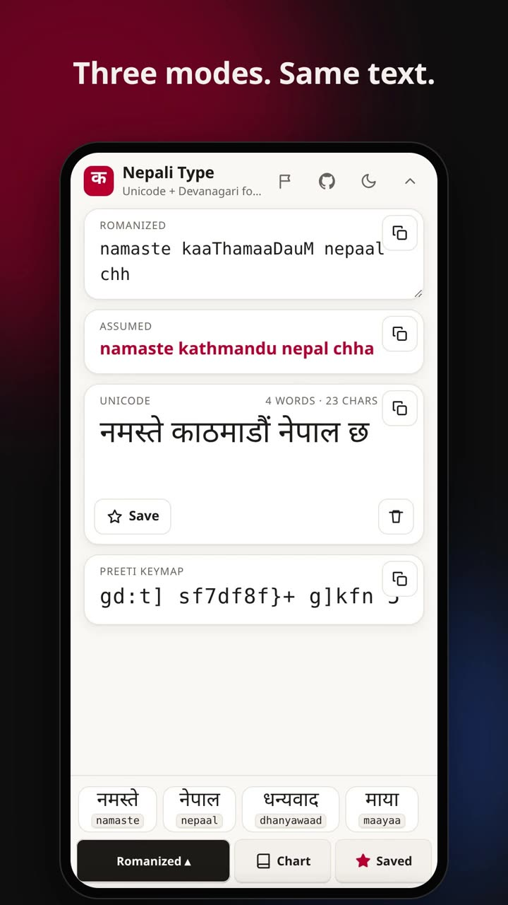

# Nepali Type

Free Nepali typing in the browser, on desktop or Android. Type Romanized Nepali (`ka` → क) with dictionary suggestions, straight into the text box or into a Romanized box, or use the classic Preeti Devanagari font layout. Unicode, Romanized and Preeti text side by side. Works offline and installs as an app.

**Live:** https://nepali-type.chandanshakya.com.np (also at https://nepali-type.pages.dev) · **Guide and cheatsheet:** [/chart/](https://nepali-type.chandanshakya.com.np/chart/)

[](https://nepali-type.pages.dev/demo.mp4)

*Tap the image to watch the demo video.*

## Features

| Feature | How to use it |
|---|---|
| **Direct mode: type in the box** | Pick **Direct** in the mode menu (bottom left). Type Romanized letters straight into the Unicode box; each word turns into Nepali when you press space, a punctuation key or Enter (`namaste` + space → नमस्ते, `.` → ।, digits → ०–९). A word that is not in the dictionary but sounds exactly like one becomes that dictionary word (`kathmandu` → काठमाडौं, `vayo` → भयो). The chips above the keyboard show what the word will become, plus dictionary words: tap one, or press <kbd>Tab</kbd> for the first. **Backspace right after a conversion gives your letters back**, so a slip is fixed by editing them. Undo (<kbd>Ctrl</kbd>+<kbd>Z</kbd>) still works, the caret can be anywhere in the text, and the Romanized, Assumed and Preeti boxes below follow as you type. Pasted Preeti keys or Latin words get a one-tap convert. |
| **Three typing modes** | The key at the bottom left opens a menu: **Direct** (type in the Unicode box), **Romanized** (type in a Romanized box, read the result below) and **Preeti** (type or paste Preeti text). **Direct** is the default for a new visit; your last choice is remembered. |
| **Romanized typing** | Type how it sounds: `ka` क, `kaa` का, `namaste` नमस्ते. A consonant alone keeps its *a* sound, and two consonants join (`kt` क्त). Works with any phone keyboard. |
| **Dictionary suggestions** | Over 4,000 common words and verb forms (everyday words, places, first names and surnames, English loanwords with their English spellings, and verb endings), built in and offline. Loose spellings still find the word: `nepal` → नेपाल, `bikas` → विकास, `kathmandu` → काठमाडौं. Tap the blue suggestion, or press <kbd>Tab</kbd> on a computer. In Preeti mode it finishes the word you're typing. |
| **Live hints** | The bar above the keyboard shows what each key did and what can come next. After `k` it offers ख, का, कि and so on. Tap a hint to type it. |
| **Preeti mode: type or paste** | Pick **Preeti** in the mode menu (bottom left; the key reads **ABC** there, and the menu takes you back). The Preeti box is a normal text box: **type** with your keyboard exactly as you would in Word with the Preeti font, or **paste** Preeti text, for example copied from a Word file, and it becomes Unicode and Romanized at once. On a phone use the on-screen Preeti keyboard and the **Paste** button. ि is typed before its letter and reph र् after it; the app puts both in the right Unicode order. |
| **Cursor and editing** | Click or tap in the Preeti box to place the caret, select and replace text, undo, or **drag the space bar** left or right (like Gboard) to move it. Typing, ⌫, hints, dictionary words and the on-screen keys all work at the caret. |
| **Assumed reading** | A card under the Romanized box shows how the text is likely said in plain letters (काठमाडौं → `kathmandu`). It has its own copy button and hides when it matches the exact spelling. Dictionary words use their familiar spelling; other words use sound rules. |
| **Paste hints** | Preeti keys pasted into Romanized mode (or Romanized words into Preeti mode) show a one-tap switch that moves the text to the right mode. In Direct mode, pasted Preeti keys or Latin words show a one-tap convert in place. |
| **Three outputs** | Unicode (for the web and modern apps), Romanized spelling (to learn a word or type it again) and Devanagari font keystrokes (to paste into Preeti documents). |
| **Same text in every mode** | Switching between Direct, Romanized and Preeti converts your text, so nothing is lost. |
| **Copy any box** | Each box has a copy button in its top-right corner. A tick shows which one was copied. |
| **Saved words** | **★ Save** keeps the word before the cursor. Saved words show up in the suggestion bar and under **★ Saved** (tap to type, × to remove). |
| **Chart and cheatsheet** | **Chart** in the bottom row and the printable [`/chart/`](https://nepali-type.chandanshakya.com.np/chart/) page show the same alphabet: vowels, consonants, the full vowel table (बाह्रखरी), half letters, conjuncts, signs, digits and specials (the font's 43 extra glyphs with their Windows Alt codes: conjuncts, ॐ ऽ and punctuation like `Û` for `!`). Every letter is shown with its Romanized spelling and its font keys, and tapping a letter in the app types it in the current mode. A jump bar takes you to any consonant in the vowel table, and **Find** in the app's chart looks up a letter by Romanized spelling (`kha`, `ksh`), font key (`v`, `S`) or Devanagari. The cheatsheet also has the font keyboard and the Romanized rules. |
| **More room** | Hide the top bar with **⌃**. Card titles disappear and the buttons become icons. Bring the bar back with **⌄** in the bottom row. |
| **Welcome video** | Plays once on your first visit. Watch it again from Chart → Help → ▶ Watch the demo. |
| **Dark mode** | Follows your system until you choose with the moon button. |
| **Install and offline** | Install button in Chrome, Edge and Android; on iPhone use Share → Add to Home Screen. After the first visit it works with no internet (the demo video needs a connection). The installed app updates itself and asks you to reload when a new version is ready; long-press its icon for shortcuts (Direct, Romanized, Preeti, Cheatsheet). `/?m=direct`, `/?m=roman` and `/?m=preeti` open a given mode. |
| **Report a problem or idea** | The **⚑** button in the top bar (also in Chart → Help) reports a missing word, a wrong conversion, a misspelled suggestion, a bug or an idea. **No account needed**: it is sent as an issue by the project, with an optional name. Prefer your own GitHub account? "Open on GitHub instead" opens the same report prefilled. After a word the dictionary does not know, a **⚑ Report** chip appears in the suggestion bar. |
| **Open and solved reports** | [`/issues/`](https://nepali-type.chandanshakya.com.np/issues/) lists reports that are still open and the ones already solved. |
| **Private** | Everything runs in your browser. Text, saved words and settings stay on your device. No account, no tracking. |

## Romanized cheat sheet

| Type | Get | Type | Get | Type | Get |
|---|---|---|---|---|---|
| `k` `ka` | क | `kaa` `kA` | का | `ki` / `kii` | कि / की |
| `ku` / `kuu` | कु / कू | `ke` / `kai` | के / कै | `ko` / `kau` | को / कौ |
| `t` / `T` | त / ट | `d` / `D` | द / ड | `n` / `N` | न / ण |
| `sh` / `Sh` | श / ष | `ch` / `chh` | च / छ | `x` `ksh` | क्ष |
| `gy` | ज्ञ | `kRi` | कृ | `M` / `~` / `H` | ं / ँ / ः |
| `\` | ् (halant) | `.` | । | `0`–`9` | ०–९ |

Two consonants in a row join (`kt` → क्त). `n` before k, kh, g or gh becomes ङ (`gangaa` → गङ्गा).

## Preeti notes

- `m` is not a letter in the font layout. It is a hook that changes the letter before it: `km` फ, `pm` ऊ, `em` झ, `qm` क्र, `Qm` क्त. A stray `m` shows in red and is left out of copied text. For म type `d`.
- `l` (ि) is typed before its letter. `{` (reph र्) is typed after it. The converter puts both in the right Unicode order.
- `0f`, `if`, `If` are single letters: ण, ष, क्ष.
- A character the Preeti font has no key for (`- : @ # & * ' " [ ] { } | ^ _ ~`, ऑ ॉ, nukta letters) is shown in red in the Preeti box. Those keys mean something else in the font (`-` is `(`, `[` is ृ), so the app never passes them through as if they were keys. Some punctuation does have a glyph, reached with an Alt code: `Û` is `!`, `Ù` is `;`, `÷` is `/`, `Ü` is `%`, `Ö` is `=`, `±` is `+`, and curly quotes. All 43 extra glyphs are in the chart's Specials tab. The rakar after the round letters ट ठ ड ढ छ ङ is typed `«`, not `|` (the font draws `|` there as a broken ढ), so राष्ट्रिय is `/fli6«o`.

## Development

Requires Node 22.12 or newer.

```bash
npm install
npm run dev       # http://localhost:4321
npm test          # converter self-check
npm run build     # static site in dist/
npm run preview   # serve dist/ locally
```

### Project layout

```
src/
  pages/index.astro     the typing app, welcome popup, SEO metadata
  data/site.js          GitHub repo link and icon, shared by both pages
  data/reports.js       report types and fields: the app form, the server and the GitHub forms all use it
  server/reports.js     report and issue-list logic (no secrets), used by the functions and the tests
  pages/issues.astro    open and solved reports page
  ../.github/ISSUE_TEMPLATE/  issue forms for the report types
  pages/chart.astro     printable cheatsheet, rendered at build time
  styles/base.css       theme tokens shared by both pages
  scripts/nepali.js     conversion logic (Preeti ⇄ Unicode, Romanized → Unicode), no DOM
  scripts/app.js        UI: modes, keyboard, hints, dictionary, saved words, theme, install
  scripts/direct.js     Direct mode: converting the Romanized word at the caret (pure functions)
  scripts/charts.js     the alphabet shown by the in-app chart and the cheatsheet
  components/Cell.astro one cheatsheet cell
  data/words.txt        dictionary: one word per line, optional extra spellings after it
functions/api/          Cloudflare Pages Functions: report.js (POST) and issues.js (GET)
public/
  sw.js                 service worker; the build fills in the file list and version
  manifest.webmanifest  PWA manifest
  icon*, og.png         icons and social preview image
  demo.mp4, demo.jpg    demo video (welcome popup, cheatsheet, README) and its poster
  sitemap.xml, robots.txt, _headers   SEO and hosting headers
astro.config.mjs        site URL and the precache build hook
test.mjs                assertions for the converters
```

## Deploy

`npm run build` writes a fully static site to `dist/`. Host it on any static host (Cloudflare Pages, Netlify, Vercel, GitHub Pages, nginx).

- Build command: `npm run build`
- Output directory: `dist`
- The `functions/` folder is deployed automatically by Cloudflare Pages (no extra setting). Anonymous reports need the `GITHUB_TOKEN` secret: see "Reports, anonymous or with GitHub".
- Serve it over HTTPS. Service workers and the Install button need it.
- The site runs on Cloudflare Pages at `nepali-type.pages.dev`, with `nepali-type.chandanshakya.com.np` as its custom domain. Canonical and Open Graph URLs come from `site` in `astro.config.mjs`, so search engines treat the custom domain as the main address. If you move domains, change `site`.
- Don't let a CDN cache `sw.js` for long. Browsers check it for updates. `public/_headers` sets this (and long caching for hashed assets) on Cloudflare Pages and Netlify.

## Adding dictionary words

Add a line to `src/data/words.txt`. Put more common words higher, because order is the ranking. The dictionary is a separate file that loads in the background after the page is ready, so a bigger list does not slow the first load. For names and English loanwords, add extra spellings after the word: `काठमाडौं kathmandu ktm`. Then run `npm test`. It lists any word that can't be typed back in Romanized mode.

## Reports, anonymous or with GitHub

Anyone can report a missing word, a wrong conversion, a bug or an idea from the **⚑** button, without an account. The app sends it to `/api/report`, a Cloudflare Pages Function (`functions/api/report.js`, logic in `src/server/reports.js`) that creates a GitHub issue **as the project owner** using a token that only exists in Cloudflare. If the person typed a name it is shown in the issue and on the reports page; otherwise the issue says it was reported anonymously. "Open on GitHub instead" opens the same report as a prefilled issue under the person's own account (the forms in `.github/ISSUE_TEMPLATE/`).

`/issues/` lists open and solved reports through `/api/issues`, which reads the repo's issues (cached for 5 minutes) and leaves out pull requests and anything labelled `spam` or `invalid`.

**One-time setup** (the site works without it, but anonymous sending then says it is not set up and points people to "Open on GitHub instead"):

1. On GitHub: Settings → Developer settings → Fine-grained personal access tokens → Generate new token. Resource owner: you. Repository access: **Only select repositories** → this repo. Permissions: **Issues: Read and write** (nothing else). Pick an expiry and note the date.
2. In Cloudflare: Workers & Pages → this project → Settings → Variables and Secrets → add a **secret** named `GITHUB_TOKEN` with that token, for Production (and Preview if you use it). Optional variable `GITHUB_REPO` (`owner/name`) if the repo is not `ChandanShakya/nepali-type`. Redeploy once.
3. Create the labels the reports use, so they are applied: `missing word`, `conversion`, `dictionary`, `idea` (`bug` exists by default).
4. Recommended: Cloudflare → Security → WAF → Rate limiting rules: for requests to `/api/report`, limit to about 5 per 10 minutes per IP. The function also limits to 5 reports an hour per network address, but that check is per data centre and best effort.

**Protection built in:** a report is only accepted from the site's own pages, is limited in size, has `@mentions` and `#123` links broken so it cannot notify or link anyone, has a hidden field that bots fill in, and is rate limited. Stranger-written text is public: close or delete spam on GitHub, or add the `spam` label to hide an issue from the reports page.

**Run it locally:** `npm run build`, then `npx wrangler pages dev dist --binding GITHUB_TOKEN=... --binding GITHUB_REPO=owner/name`. For a pretend GitHub, add `--binding GITHUB_API=http://127.0.0.1:PORT`. Never put the token in the repo; for local use put it in `.dev.vars` (ignored by git).

`npm test` checks the report forms, the field names the app fills in, the spam checks, the rate limit and the issue list against a pretend GitHub.

## Privacy

Everything runs in your browser. Text, saved words and settings are stored only in your browser's local storage. The only thing that ever leaves the page is a report, and only when the person presses **Send report** (or opens it on GitHub): then the fields shown in the form, plus the optional name, are posted publicly as a GitHub issue. There is no tracking and no account.

## License

MIT

## Credits

The 30 extra Preeti glyphs were checked against two independent tables: the npttf2utf map (as in the npm `preeti` package) and [Lekh](https://github.com/Amunet98/lekh) (MIT). The idea of texting spellings (`vayo`, `tapaailai`) and of a readable "assumed" line also came from Lekh; the code here is written separately.
Several fixes (commas in Preeti output, the rakar after round letters, backspace on phone keyboards, sarkar/pradhanmantri spellings) came from testing and feedback by the author of Lekh and r/technepal.
